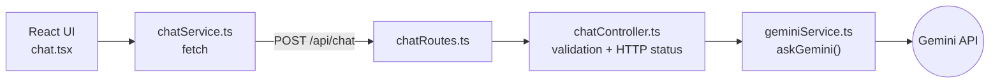

# Gemini Chatbot

**English** | [Português](README.pt-BR.md)

A small full-stack AI chat built as a technical challenge: a React + TypeScript frontend talks to a Node.js/Express API, which forwards each message to Google's Gemini model and returns the reply. The goal was not feature count but a clean, testable baseline: a thin backend split into route, controller and service layers, the Gemini SDK isolated behind one function, configuration that fails fast at startup, and a test suite that never hits the real API.

## Technical highlights

- **Layered backend (Route → Controller → Service).** Routes only map endpoints, the controller validates input and shapes HTTP responses, and the service owns the external integration. → [`chatRoutes.ts`](backend/src/routes/chatRoutes.ts), [`chatController.ts`](backend/src/controllers/chatController.ts), [`geminiService.ts`](backend/src/services/geminiService.ts)
- **Gemini SDK behind a single function.** `askGemini(message)` wraps the official `@google/genai` client (Interactions API, `gemini-3.8-flash`), so swapping the model or provider touches one file. → [`geminiService.ts`](backend/src/services/geminiService.ts)
- **Fail-fast configuration.** A missing `GEMINI_API_KEY` stops the server at startup instead of failing on the first request; the frontend does the same for `VITE_API_URL`. → [`config/env.ts`](backend/src/config/env.ts), [`chatService.ts`](frontend/src/services/chatService.ts)
- **App and server split for testing.** [`app.ts`](backend/src/app.ts) builds the Express app without listening, and [`server.ts`](backend/src/server.ts) starts it, which lets Supertest exercise the real routes in-process.
- **Tests with the external API mocked.** Unit tests for the controller and the service, plus an HTTP test with Supertest, all with Gemini mocked through `vi.mock`, so they are fast, deterministic and free of quota usage. → [`backend/src/tests/`](backend/src/tests/)
- **Clear error contract.** Empty or missing messages return `400`, Gemini failures are logged and return `500`, and the UI turns any failure into a friendly message. → [`chatController.ts`](backend/src/controllers/chatController.ts), [`chat.tsx`](frontend/src/components/chat.tsx)
- **Typed, lean frontend.** React 19 with local state in one component (no global store for a single screen), a typed `Message` model, a loading indicator, and Tailwind CSS 4 via the Vite plugin. → [`chat.tsx`](frontend/src/components/chat.tsx), [`types/chat.ts`](frontend/src/types/chat.ts)

## Architecture



| Layer | Stack |
|---|---|
| Frontend | React 19, TypeScript, Vite, Tailwind CSS, ESLint |
| Backend | Node.js, Express 5, TypeScript, `@google/genai`, dotenv |
| Tests | Vitest, Supertest |

### API

| Method | Path | Body | Response |
|---|---|---|---|
| `GET` | `/health` | | `{ "status": "ok" }` |
| `POST` | `/api/chat` | `{ "message": "Hello" }` | `200 { "reply": "..." }` |
| | | missing or blank `message` | `400 { "error": "Message is required" }` |
| | | Gemini failure | `500 { "error": "Could not generate a response" }` |

## Running and testing

Requirements: Node.js, npm and a Gemini API key from [Google AI Studio](https://aistudio.google.com/).

**Backend** (port 3001):

```bash
cd backend
npm install
cp .env.example .env      # set GEMINI_API_KEY (PORT defaults to 3001)
npm run dev
```

**Frontend** (port 5173), in a second terminal:

```bash
cd frontend
npm install
cp .env.example .env      # VITE_API_URL=http://localhost:3001
npm run dev
```

Then open <http://localhost:5173>.

**Checks:**

```bash
cd backend && npm test          # Vitest (watch mode); use `npx vitest run` for a single run
cd backend && npm run build     # compiles to backend/dist
cd frontend && npm run build    # type-check + production bundle
cd frontend && npm run lint
```

Only the `.env.example` files are versioned; real `.env` files, `node_modules` and `dist` are ignored.

## Status

Complete for the scope of the challenge: 5 backend tests passing, and the frontend builds and lints cleanly. The scope was kept small on purpose; natural next steps would be conversation history sent to the model, streaming responses and frontend component tests.
