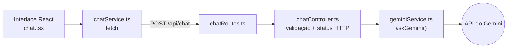

# Gemini Chatbot

[English](README.md) | **Português**

Chat com IA full-stack feito como desafio técnico: o frontend em React + TypeScript conversa com uma API em Node.js/Express, que repassa cada mensagem ao modelo Gemini, do Google, e devolve a resposta. O objetivo não era ter muitas funções, e sim uma base limpa e testável: backend enxuto separado em rota, controller e service, o SDK do Gemini isolado numa única função, configuração que falha logo na inicialização e testes que nunca chamam a API real.

## Destaques técnicos

- **Backend em camadas (Rota → Controller → Service).** A rota só mapeia o endpoint, o controller valida a entrada e monta a resposta HTTP, e o service cuida da integração externa. → [`chatRoutes.ts`](backend/src/routes/chatRoutes.ts), [`chatController.ts`](backend/src/controllers/chatController.ts), [`geminiService.ts`](backend/src/services/geminiService.ts)
- **SDK do Gemini atrás de uma função.** `askGemini(message)` encapsula o cliente oficial `@google/genai` (Interactions API, `gemini-3.8-flash`); trocar o modelo ou o provedor mexe em um arquivo só. → [`geminiService.ts`](backend/src/services/geminiService.ts)
- **Configuração que falha cedo.** Sem `GEMINI_API_KEY`, o servidor não sobe, em vez de falhar no primeiro pedido; o frontend faz o mesmo com `VITE_API_URL`. → [`config/env.ts`](backend/src/config/env.ts), [`chatService.ts`](frontend/src/services/chatService.ts)
- **App separado do servidor.** O [`app.ts`](backend/src/app.ts) monta o Express sem abrir porta e o [`server.ts`](backend/src/server.ts) o inicia, o que permite ao Supertest testar as rotas reais no mesmo processo.
- **Testes com a API externa mockada.** Testes unitários do controller e do service, mais um teste HTTP com Supertest, todos com o Gemini mockado via `vi.mock`: rápidos, determinísticos e sem gastar cota. → [`backend/src/tests/`](backend/src/tests/)
- **Contrato de erro claro.** Mensagem vazia ou ausente devolve `400`, falha do Gemini é registrada no log e devolve `500`, e a interface mostra uma mensagem amigável para qualquer falha. → [`chatController.ts`](backend/src/controllers/chatController.ts), [`chat.tsx`](frontend/src/components/chat.tsx)
- **Frontend tipado e enxuto.** React 19 com estado local num componente (sem store global para uma tela só), modelo `Message` tipado, indicador de carregamento e Tailwind CSS 4 pelo plugin do Vite. → [`chat.tsx`](frontend/src/components/chat.tsx), [`types/chat.ts`](frontend/src/types/chat.ts)

## Arquitetura



| Camada | Tecnologias |
|---|---|
| Frontend | React 19, TypeScript, Vite, Tailwind CSS, ESLint |
| Backend | Node.js, Express 5, TypeScript, `@google/genai`, dotenv |
| Testes | Vitest, Supertest |

### API

| Método | Caminho | Corpo | Resposta |
|---|---|---|---|
| `GET` | `/health` | | `{ "status": "ok" }` |
| `POST` | `/api/chat` | `{ "message": "Olá" }` | `200 { "reply": "..." }` |
| | | `message` ausente ou em branco | `400 { "error": "Message is required" }` |
| | | falha do Gemini | `500 { "error": "Could not generate a response" }` |

## Como rodar e testar

Requisitos: Node.js, npm e uma chave da API do Gemini, criada no [Google AI Studio](https://aistudio.google.com/).

**Backend** (porta 3001):

```bash
cd backend
npm install
cp .env.example .env      # preencha GEMINI_API_KEY (PORT padrão: 3001)
npm run dev
```

**Frontend** (porta 5173), em outro terminal:

```bash
cd frontend
npm install
cp .env.example .env      # VITE_API_URL=http://localhost:3001
npm run dev
```

Depois, abra <http://localhost:5173>.

**Verificações:**

```bash
cd backend && npm test          # Vitest (modo watch); use `npx vitest run` para rodar uma vez
cd backend && npm run build     # compila para backend/dist
cd frontend && npm run build    # checagem de tipos + bundle de produção
cd frontend && npm run lint
```

Só os arquivos `.env.example` vão para o repositório; os `.env` reais, o `node_modules` e o `dist` são ignorados.

## Status

Completo para o escopo do desafio: 5 testes do backend passando, e o frontend compila e passa no lint sem erros. O escopo ficou pequeno de propósito; os próximos passos naturais seriam mandar o histórico da conversa ao modelo, respostas em streaming e testes de componente no frontend.
